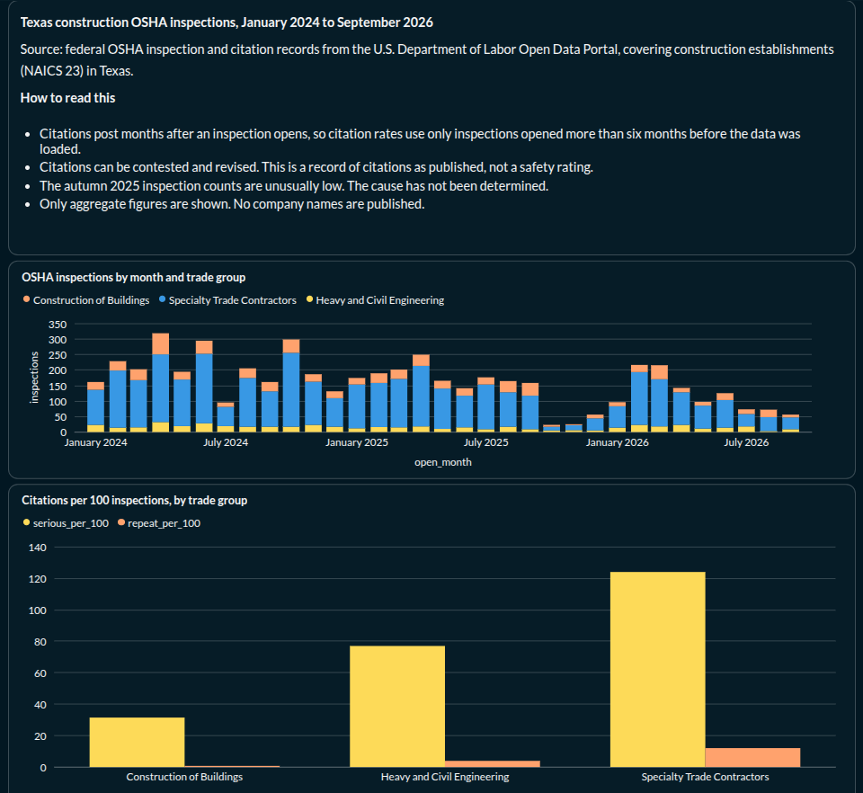

# Texas Construction Safety Pipeline

An ELT pipeline that loads federal OSHA inspection and citation records for Texas construction employers from the U.S. Department of Labor Open Data Portal API, models them with dbt, and publishes aggregate safety analytics in Metabase. It runs on a self-hosted Proxmox VM in Docker Compose, orchestrated by Airflow.



The warehouse holds about 5,300 inspections (January 2024 to September 2026) and the citations issued from them.

**Privacy by design:** OSHA publishes employer records, and some employers are sole proprietors named after a person. This project classifies establishments conservatively, so ambiguous names are treated as individuals and kept out of any ranking, and the dashboard database role can read only an aggregate table with no company names.

## Stack

| Layer | Tool |
|---|---|
| Orchestration | Apache Airflow 2.10 (LocalExecutor) |
| Warehouse | PostgreSQL 16 |
| Transformation and testing | dbt-postgres 1.9 |
| BI | Metabase |
| Infrastructure | Docker Compose on a Proxmox VM (Ubuntu 24.04) |

## Data flow

1. Airflow runs the loader daily. It pulls new Texas construction inspections (NAICS 23) and re-fetches citations for recent inspections, since citations post months after an inspection opens.
2. Raw JSON lands untouched in Postgres (`raw` schema), upserted on OSHA's natural keys.
3. dbt parses it into `staging`, builds the `marts`, and runs its tests after every load.
4. Metabase reads one aggregate mart through a read-only role.

## Quick start

**Requirements:** Docker with Compose, and a free API key from the [DOL Open Data Portal](https://dataportal.dol.gov/registration) (sign in with Login.gov, then create a key under API Keys).

**1. Clone and configure**

```bash
git clone git@github.com:itxos/construction-risk-pipeline.git
cd construction-risk-pipeline
cp .env.example .env
```

Edit `.env` and set your own values:

| Variable | Notes |
|---|---|
| `DOL_API_KEY` | Your DOL API key |
| `POSTGRES_USER`, `POSTGRES_PASSWORD`, `POSTGRES_DB` | Any values you like |
| `AIRFLOW_ADMIN_PASSWORD` | Password for the Airflow `admin` user |
| `AIRFLOW_FERNET_KEY` | Generate with the command below |

```bash
python3 -c "import base64,os; print(base64.urlsafe_b64encode(os.urandom(32)).decode())"
```

**2. Start the stack**

```bash
docker compose build
docker compose up -d
```

On first start, Postgres creates the `raw`, `staging`, and `marts` schemas, the raw tables, and the Airflow and Metabase databases.

**3. Create the dashboard role** (before the first dbt run)

```bash
docker exec -it construction-postgres psql -U <POSTGRES_USER> -d <POSTGRES_DB> -c "
CREATE ROLE metabase_ro LOGIN PASSWORD 'choose_a_password';
GRANT CONNECT ON DATABASE <POSTGRES_DB> TO metabase_ro;
GRANT USAGE ON SCHEMA marts TO metabase_ro;"
```

dbt grants this role read access to the one aggregate table, `mart_inspections_monthly`, and nothing else.

**4. Run the pipeline**

1. Open Airflow at `http://localhost:8081` and log in as `admin`.
2. Un-pause `osha_construction_daily` and trigger it once.
3. The DOL API rate-limits bulk loads. When it does, the load tasks show as **skipped** (pink), not failed, and progress is saved. The next daily run resumes where the last one stopped, so the full history takes several runs.

**5. View the dashboard**

Open Metabase at `http://localhost:3001`, create an admin account, and connect PostgreSQL with host `postgres`, port `5432`, your database name, and the `metabase_ro` credentials from step 3.

| Service | URL |
|---|---|
| Airflow | http://localhost:8081 |
| Metabase | http://localhost:3001 |
| Postgres | localhost:5433 |

## Design decisions

**Raw JSON first (ELT).** Each API record is stored untouched in `raw` as JSONB, keyed by OSHA's natural identifiers (`activity_nr`, and `activity_nr` + `citation_id`). Loads are upserts, so re-runs never create duplicates, and a modeling mistake is fixed by re-running dbt, not by re-calling a rate-limited API.

**Keyset pagination.** The loader pages by "activity number greater than the last one loaded" instead of by offset, so it can stop and resume at any point, and it verifies that each page really arrives sorted before writing it. Each page of inspections and its citations is written in one transaction.

**Designed around an undocumented rate limit.** The DOL API returns HTTP 429 after a burst of requests, and I could not find a documented limit. The loader waits with increasing backoff, saves progress, and exits with a distinct code. Airflow treats that code as "skipped," not "failed," so the dbt tasks still run on whatever loaded and the next daily run resumes. Request sizes were found by testing: 100 inspection IDs per citation request works, and 200 is rejected with a 403.

**Citations arrive late, so the pipeline revisits them.** Citations post months after an inspection opens. The daily DAG therefore has a second task that re-fetches citations for inspections opened in the last 270 days. Only a few citations had posted in the first day after the initial load, so the refresh is working but its benefit builds up slowly.

**A maturity rule in the model.** In the loaded data, the share of inspections with citations stays in a steady band through early 2026 and then drops toward zero for the most recent months. That is a lag effect, not safer worksites, so dbt flags inspections opened less than six months before the build as not yet mature, and every rate and score uses only mature inspections.

**Layered models.** `raw` (untouched JSON) → `staging` (typed, deleted citations removed) → `marts` (one row per inspection, a contractor dimension, a risk score, and a monthly aggregate). dbt tests run after every build.

## Data quality findings

1. **Deleted citations carry penalties that were never owed.** Records flagged as deleted often show an initial penalty with a current penalty of zero. In the first load, 375 of 7,073 citations were flagged deleted, so staging excludes them.
2. **Citation lag.** The share of inspections with citations falls from roughly half or more for older months to near zero for the last six months. Dashboard rates use mature months only.
3. **Unexplained dip in autumn 2025.** October and November 2025 contain far fewer inspections (23 and 25) than typical months (about 150 to 250). The cause has not been determined, and the dashboard says so.
4. **Messy establishment names.** Basic normalization (case, punctuation, company suffixes) merged only a handful of names among the first 1,000 inspections, so within this dataset, simple cleaning goes most of the way. Fuzzier matching would matter when joining other sources, which this project does not yet do.

## Privacy

OSHA publishes employer records, and many Texas construction employers are sole proprietors named after a person. The project handles this in layers:

- A **conservative classifier** treats a name as a business only if it carries a business or trade word. Ambiguous names count as individuals. In a spot check of 25 excluded names, 2 were real businesses (an error rate that is deliberate: excluding a business is cheaper than exposing a person). The word list was tightened once after an earlier check found 5 of 25.
- The **risk score** (serious = 1, repeat = 3, willful = 5, other = 0; businesses with at least 3 mature inspections) is computed in the warehouse but is **not published by name**. These weights are my own assumption, not an OSHA formula.
- A dbt test fails the build if a non-business ever enters the ranking.
- The **dashboard database role** can read only the monthly aggregate table, so company names cannot reach the dashboard even by mistake.
